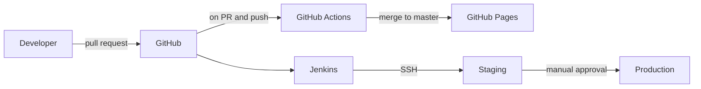

<div align="center">

# DevOps Essentials Sample App

A static site delivered through an automated build, test and deploy pipeline.

[](https://github.com/Gurmeta/devops-essentials-sample-app/actions/workflows/ci.yml)
[](https://gradle.org)
[](Jenkinsfile)
[](https://gurmeta.github.io/devops-essentials-sample-app/)
[](LICENSE)

**[Live site](https://gurmeta.github.io/devops-essentials-sample-app/)** · [Pipeline runs](https://github.com/Gurmeta/devops-essentials-sample-app/actions) · [Jenkinsfile](Jenkinsfile)

</div>

---

## Overview

The project started as a course lab exercise and was reworked into a small reference for continuous delivery. The site itself is intentionally simple (plain HTML, CSS and a little JavaScript) so the focus stays on how it gets built, verified and released.

- **Build:** Gradle checks that the site is complete and packages it as a zip.
- **Verify:** GitHub Actions builds every pull request and validates the HTML.
- **Publish:** merges to `master` deploy the site to GitHub Pages.
- **Release:** a Jenkins pipeline promotes the artifact to staging, waits for approval, then deploys to production over SSH.

## Architecture



| Stage | Tool | What happens |
| --- | --- | --- |
| Build | Gradle | Verifies required files, packages `src/` into a zip |
| Verify | GitHub Actions | Runs `./gradlew build` and validates `src/index.html` |
| Pages | GitHub Actions | Publishes `src/` to GitHub Pages on every merge to `master` |
| Staging | Jenkins | Publishes `src/` to the staging host over SSH |
| Production | Jenkins | Same publish step, gated by a manual approval |

## Tech stack

| Area | Technology |
| --- | --- |
| Frontend | HTML, CSS (custom properties, light and dark themes), vanilla JavaScript |
| Build | Gradle 8.10.2 via wrapper, JDK 17 |
| CI | GitHub Actions on `ubuntu-24.04` |
| Release | Jenkins declarative pipeline, Publish over SSH plugin |
| Hosting | GitHub Pages, plus SSH targets for staging and production |

## Project layout

```
.
├── src/
│   ├── index.html          Page markup, architecture diagram, config excerpts
│   ├── css/styles.css      Styles and theme tokens
│   ├── js/main.js          Theme toggle and scroll animations
│   └── favicon.svg
├── build.gradle            verifySite and siteZip tasks
├── Jenkinsfile             Build and deploy pipeline
├── .github/workflows/      CI and Pages workflow
├── gradle/wrapper/         Gradle wrapper (8.10.2)
└── LICENSE
```

## Getting started

The site has no runtime dependencies. Open `src/index.html` in a browser, or serve the folder:

```bash
python3 -m http.server --directory src 8080
# or
npx serve src
```

Build and verify with Gradle (requires JDK 17 or newer):

```bash
./gradlew build          # verify and package
./gradlew verifySite     # only check required files
./gradlew siteZip        # only create the archive
```

The archive is written to `build/distributions/devops-essentials-sample-app.zip`.

## Build details

`build.gradle` applies the `base` plugin and adds two tasks:

| Task | Wired into | Purpose |
| --- | --- | --- |
| `verifySite` | `check` | Fails the build if `index.html`, `css/styles.css`, `js/main.js` or `favicon.svg` is missing |
| `siteZip` | `assemble` | Packages `src/` as a zip artifact |

## CI/CD

### GitHub Actions

`.github/workflows/ci.yml` runs on pull requests and pushes to `master`:

1. **build:** sets up Temurin JDK 17 and Gradle, runs `./gradlew build`, validates the HTML with `html-validate`, and uploads the zip as an artifact.
2. **deploy-pages:** runs only on pushes to `master`. It appends the short commit SHA to the stylesheet and script URLs so browsers never combine new HTML with cached old assets, then deploys `src/` to GitHub Pages.

The workflow uses read-only repository permissions by default. Only the Pages job requests `pages: write` and `id-token: write`, and concurrent runs for the same ref are cancelled.

### Jenkins

The `Jenkinsfile` defines three stages: **Build** (Gradle build and archived artifact), **Deploy to staging**, and **Deploy to production**. Both deploy stages run only on `master` and share a single `deployTo()` helper. The production stage waits behind an `input` step, so nothing is released without an explicit approval.

To use it, define two servers named `staging` and `production` under *Manage Jenkins → System → Publish over SSH*. Their credentials live in Jenkins and are never stored in this repository.

## Branch protection

`master` is protected by a ruleset: changes go through a pull request, the `build` check must pass, force pushes are blocked and the branch cannot be deleted. Merged branches are deleted automatically.

## Contributing

1. Create a branch from `master`.
2. Run `./gradlew build` locally.
3. Open a pull request and wait for the `build` check to pass.

## License

Released under the [MIT License](LICENSE).
